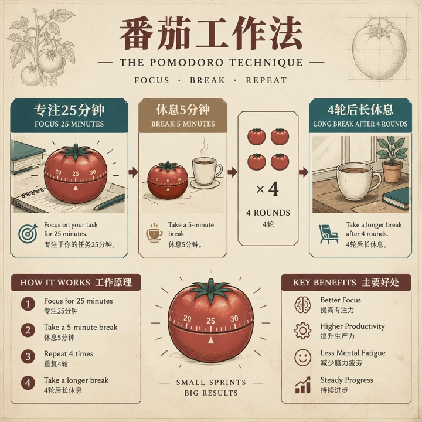
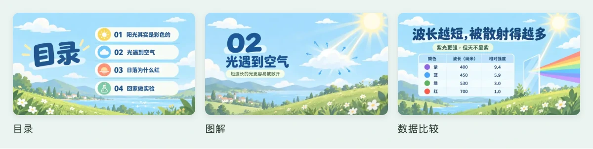

# 叁笙生图 · Sansheng Image

**中文** | [English](./README_EN.md)

**给 Agent 的生图 Skill。** 把文章或想法交给 Claude Code、Codex 等 Agent，读懂内容，选定画风，画出一整组风格一致的图。

<p align="center">
  <a href="https://sanshengai.top/tools/image/">
    
  </a>
</p>

<h3 align="center"><a href="https://sanshengai.top/tools/image/">进入视觉看板，挑画风与色系 →</a></h3>

<p align="center">按用途看样图 → 选择画风与色系 → 复制指令给 Agent</p>

<p align="center"><a href="#三步开始">安装与试用</a> · <a href="#看实际效果">静态样图</a> · <a href="#让文章里的一段话动起来">动态演示</a> · <a href="./CHANGELOG.md">更新日志</a></p>

> 公开 beta：82 种画风可浏览，18 套命名色系可选；其中 C91–C98 共 8 款已正式准入。可浏览、可编译与通过实际用途验收是不同状态，详见 [能力边界](#当前能力与边界)。

<!-- PROMO_VIDEO:START -->
<!-- 宣传视频固定插入位：成片完成后，在这对标记之间加入标题、真实封面与播放链接；上线前保持隐藏。 -->
<!-- PROMO_VIDEO:END -->

## 为什么用它

- **懂内容**：先读上下文，找出值得画的场景、步骤、对比与关系，把重点画进图里。
- **多面手**：公众号 / X 封面与配图、小红书、PPT、信息图、漫画、绘本、视频分镜，沿用同一套选图与出图流程。
- **风格准**：画风有专有提示词和参考图；同一系列锁定画风，构图随每一段内容变化。
- **好色彩**：用有名字、有故事的色系确定主色、点缀与留白；换色仍须尊重画风本身的配色规则。

## 看实际效果

### 文章插图与知识解释

人物叙事可以用一幅场景承接情绪；解释方法则用步骤、对比和关系。表达结构由内容决定。

<p>
  <a href="https://sanshengai.top/tools/image/#u=wxillus&s=C01"></a>
  <a href="https://sanshengai.top/tools/image/#u=info&s=C32"></a>
</p>

<sub>左：C01 暖光手绘动画；右：C32 旧纸技术简报。均为实际生成的单张样图。</sub>

### 小红书：从封面到收尾

同一种纸雕语言，贯穿封面、内容页和收尾清单。下图选自「一桌下午茶」六页样图中的三页。

[](https://sanshengai.top/tools/image/#u=xhs&s=C27)

<sub>C27 纸雕层叠 ·「一桌下午茶」六页选三。点图可在看板中查看完整样图。</sub>

### PPT：同一种画风，不同页型

目录页、图解页、数据页分别组织信息；画面风格保持一致。

[](https://sanshengai.top/tools/image/#u=ppt&s=C42)

<sub>C42 清透扁平 · 图像式 PPT 选页。整页输出为图片，可选组装为 PPTX；页内元素不是可编辑对象，中文显示需在目标软件核对。</sub>

漫画、绘本、音乐封面与视频分镜等样图，也可以在 [视觉看板](https://sanshengai.top/tools/image/) 按用途查看。分镜产出为静态首帧，不生成完整视频。

## 让文章里的一段话，动起来

当一段内容需要解释过程，可以让同一条信息依次经历接收、分类建议、程序核对和人工接手。动效服务于理解，而不是让所有元素都跳进来。

[](https://sanshengai.top/tools/image/motion/article-message/share.gif)

<sub>《一条留言怎样走完》· 点图播放官网完整 GIF。演示中的程序核对只检查格式与范围，不保证分类正确。</sub>

作品墙按 **人像合影、知识图解、风景意境、相册手账** 四类展示，每类两件，以 9:16 原图与 16:9 动态紧邻对照。静态图是默认输出，明确要求动态版才开启；实际制作可沿用已有横向原图。

动态统一从 `python3 scripts/sb.py animate wake` 进入：继承原文、画风与色系，先判断图是否适合动，再备料、编排、预览与审片。首次环境由 Agent 按 [动态手册](./references/motion-wake.md) 配置，用户保持一个 Skill 入口。上游 lemo-wake 作为外部依赖，其 **CC BY-NC 4.0** 与相关素材许可单独适用。

## 三步开始

### 1. 安装到 Agent

```bash
npx skills add sanshengai/sansheng-image -g
```

需要 Node.js、Python 3.10+，以及能执行本机命令的 Agent。也可以把仓库链接交给 AI 助手，请它替你安装。[手动安装与环境检查](./USAGE.md#安装与环境检查)。

### 2. 去看板，选一套喜欢的视觉

在上方看板入口中选用途、画风与色系，复制一行 `sb2:` 选择码交给 Agent。只用这一次，或保存为浏览器内的默认选择，都可以。

### 3. 交给它一段真实内容

```text
给这篇文章做一张封面和三张插图。
沿用刚才选定的画风与色系，先给我配图计划，再逐张出图。
```

实际成图需要宿主内置生图工具或已配置的图像服务；Codex 内置工具使用其订阅额度，外部服务按各自规则计费。仅编译提示词不会自动产生图片。

<details>
<summary>想先检查提示词与尺寸，不调用生图服务</summary>

在仓库目录运行：

```bash
python3 scripts/sb.py compile examples/quickstart/manifest.json --json
```

这个虚构示例会列出画风、尺寸、完整提示词和参考图。后续出图与独立看图检查见 [使用指南](./USAGE.md#第一次编译与出图)。

</details>

## 当前能力与边界

| 能做什么 | 怎样理解它的当前状态 |
|---|---|
| 浏览与编译画风 | 82 种公开画风合同；C91–C98 已正式准入，其余 74 款待准入。看板可选不等于任意用途、色系均已验收。 |
| 从文章规划配图 | 支持原文依据、逐图结构、单张 / 批量生成、局部返修和质量记录；事实、文字、裁切与整组效果仍需看实际成图。 |
| 小红书、信息图、漫画、绘本、音频封面等 | 可制作并查看样图；发布前仍需在目标平台检查文字、裁切和整组效果。 |
| PPT | 整页为图片，可选组装为 PPTX；不承诺页内元素可编辑。 |
| 视频分镜 | 静态首帧与运动文字说明；角色、光线与跨镜头一致性逐组检查，不生成完整视频。 |
| 动态插图 | 官网八件完成制作审片与浏览器播放；历史单支 GIF 有公众号手机反馈，历史三支有 X 桌面草稿预览。结论只绑定当时文件，不推及本批全部作品或自动上传接口；小红书 GIF 图文尚未核实。 |
| 偏好与记忆 | 明确设置存本机，可查看、撤销与忘记；长期推荐效果仍需连续使用验证，不提供跨设备同步。 |

出厂默认 C24（公众号插图 / 表情包）、C31（小红书）、C40（信息图）、C30（公众号封面）仍待正式准入。默认推荐、网页可选和正式准入分别记录；也可以自行明确选择画风。

安装包包含画风合同、参考锚点与少量 README 展示图，**不含官网完整样图库**。样图来源与验证范围见 [图片来源](./ASSET_PROVENANCE.md)；生图服务的实测范围见 [后端说明](./references/backends.md)。

## 文档与进阶用法

| 想做的事 | 去哪里看 |
|---|---|
| 安装、环境检查、第一次出图 | [使用指南](./USAGE.md) |
| 用一个轻量计划逐张出图 | [轻量出图](./references/quick.md) |
| 从原文规划整篇文章的插图 | [内容规划](./references/planning.md) |
| 接入图像服务与独立看图复核 | [生图与复核后端](./references/backends.md) |
| 换色、改构图、保存或撤销偏好 | [选择与修改](./references/selection.md) · [本地偏好](./references/preferences.md) |
| 漫画、绘本与固定人物 | [人物一致性](./references/consistency.md) |
| 视频静态分镜 | [分镜手册](./references/scenes/storyboard.md) |
| 制作动态、查看工程与反例 | [动态制作](./references/motion-wake.md) · [已审工程](./examples/motion/README.md) |
| 维护样图、README 媒体与视频插入位 | [维护指南](./MAINTAINERS.md) |

## 更新、贡献与许可

[更新日志](./CHANGELOG.md) · [GitHub Releases](https://github.com/sanshengai/sansheng-image/releases) · [参与贡献](./CONTRIBUTING.md)

推荐画风、报告问题可使用仓库 Issue 模板；代码与文档改进欢迎 Pull Request。网站投稿入口尚未上线。

原始代码与项目自有内容采用 [MIT License](./LICENSE)。第三方代码、字体、参考图和可选动态依赖保留各自许可，详见 [THIRD_PARTY_NOTICES.md](./THIRD_PARTY_NOTICES.md)。

感谢 [threerocks/hand-drawn-styles](https://github.com/threerocks/hand-drawn-styles)、[JimLiu/baoyu-skills](https://github.com/JimLiu/baoyu-skills)、[yang0/handraw-style](https://github.com/yang0/handraw-style) 与 [Lemomo/lemo-wake](https://github.com/lemomo-ai/lemo-wake) 公开方法与代码。画风参考不代表与相关创作者有合作或背书关系。维护者：叁笙（sansheng）。
